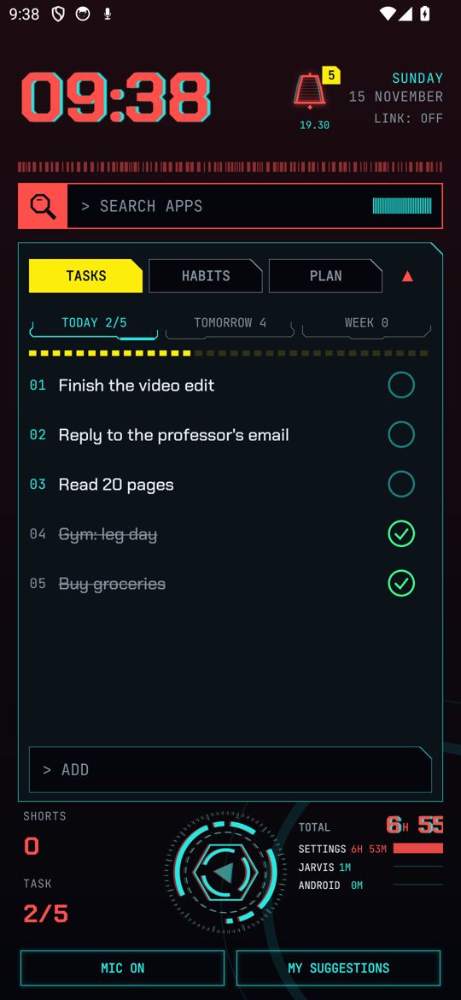
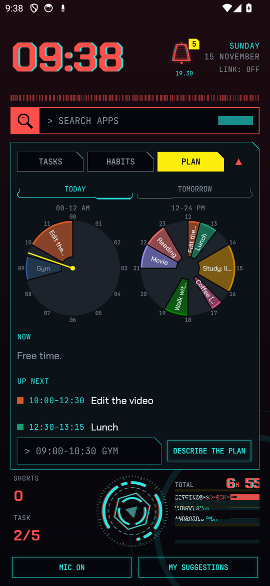
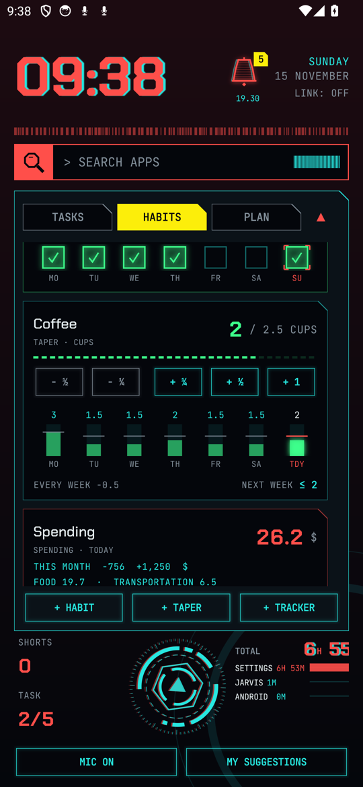
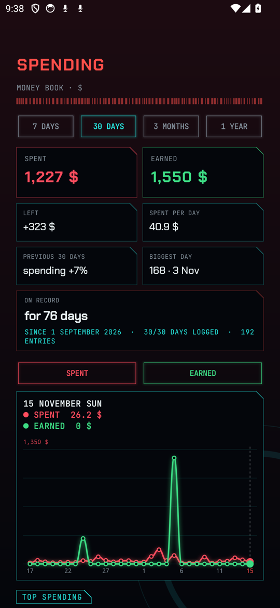
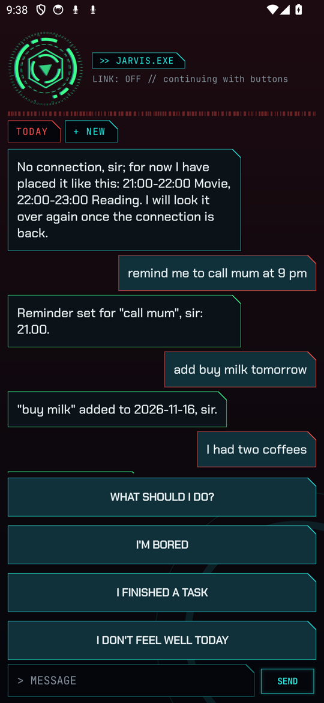

# Jarvis

**An Android home screen that replaces your apps with an assistant.**

Jarvis takes over your phone's home screen. Instead of a grid of colourful icons there is a ring that listens. You talk to it, it keeps your day: tasks, an hourly plan, habits, money, reminders. It also quietly holds you to what you said you would do.

> No app grid to doomscroll from, no separate to-do app, habit tracker, money tracker or app blocker to forget about. One thing on the screen, and it talks back.

<p align="center">
  
  
  
  
  
</p>

## What it does

- **The home screen is the assistant.** The Jarvis ring, today's tasks, the time and today's screen time. Every other app is still there: type its name to find it.
- **Talk to it.** Long-press the ring, or say "Jarvis" (after a short [training on your voice](bridge/wake/README.md)). The wake word runs on the phone, so nothing is heard before the name.
- **Tasks.** Today, tomorrow and later, plus weekly routines. In the evening it asks you to plan tomorrow, and unfinished tasks move to the next day on their own.
- **Hourly plan.** The day on two 12-hour dials. Say it loosely ("gym at 9, class from 10:30 to 12, then two hours of reading") and it is laid out on the clock.
- **Habits.** Weekly goals, **tapers** that cut something down a little each week (coffee, for example), and daily trackers such as calories with macros.
- **Money book.** Spending and income by category, with a stats page for 7 days, 30 days, 3 months or a year.
- **Reminders.** Natural ones: "remind me to call mum at quarter to nine", "in half an hour, the oven".
- **Morning rule.** Until you are up and the morning is done, only the apps you allow will open. **Shorts watcher.** It notices when you keep scrolling YouTube Shorts and calls it out.
- **Your data is plain Markdown.** Each day is a file (`Jarvis/days/2026-11-15.md`), with ideas and notes beside it. Open the folder in Obsidian, or sync it to a PC with Syncthing.
- **Themes:** Jarvis HUD, Cyberpunk, Hextech, Ink, Pixel.

## Two ways to run it

| | **Phone only** | **Phone + bridge** |
|---|---|---|
| Setup | Build and install | Also run `bridge/` on a PC |
| Commands | Fixed English phrases: "add buy milk", "remind me at 9 pm to…", "set an alarm for 7", "I had two coffees", "gym at 9, then class" | Anything. Claude reads your day as context and answers as Jarvis |
| Speech-to-text | The phone's own recognizer | Whisper on your PC |
| Voice | The phone's TTS | Piper (British voice) on your PC |

The **bridge** is a small Python server: phone → [Tailscale](https://tailscale.com) → `claude -p` on your machine. Claude runs **with every tool disabled**, so it can only answer. Anything it wants done on the phone comes back as data, checked against a fixed list of actions. Audio is transcribed on your PC and is not sent anywhere else. You use your own Claude subscription (Claude Code), or swap in another model (see [Using a different model](#using-a-different-model)).

## Quick start

**Easiest:** open this repository in [Claude Code](https://claude.com/claude-code) and say *"set up Jarvis on my phone"*. [`CLAUDE.md`](CLAUDE.md) tells it how to do the whole setup: toolchain, build, install, permissions, and the bridge if you want it.

**By hand:**

```bash
# Needs JDK 17 and the Android SDK (platform 35). See CLAUDE.md for installing them.
./gradlew assembleDebug
scripts/setup-phone.sh            # phone connected over USB, with USB debugging on
```

`scripts/setup-phone.sh` installs the APK and grants what adb can grant: microphone, notifications, usage access, accessibility, the home role and file access. If a step fails on your phone, do it by hand:

1. Settings → Apps → Jarvis → ⋮ → **Allow restricted settings** (needed for sideloaded accessibility services)
2. Settings → Accessibility → Installed apps → **Jarvis**: on
3. Settings → Apps → Default apps → **Home app**: Jarvis
4. Settings → Apps → Jarvis → Battery: **Unrestricted**
5. Optional: Default apps → **Digital assistant**: Jarvis

**Getting out:** Settings is always reachable. Set the home app back to your old launcher, or run `adb uninstall app.jarvis`.

## Settings

Copy `app/src/main/assets/config.example.json` to `config.json` in the same folder and rebuild. Without a `config.json` the example values are used.

| Key | Meaning |
|---|---|
| `wakeFromHour`, `morningEndHour`, `eveningFromHour` | The day's phases: the morning rule runs from waking until the morning is done; the evening is for planning tomorrow |
| `morningAllowedPackages`, `…Prefixes`, `…Urls` | What may open during the morning rule |
| `shortsSwipesAllowed`, `nagMinutes` | Shorts before Jarvis speaks up, and how often after |
| `quickChatNumber` | A WhatsApp chat the morning screen can open directly (digits, international format) |
| `currency` | The money book's sign, e.g. `"$"`, `"€"`, `"£"` |
| `bridgeUrl` | `http://<your PC's Tailscale IP>:8787`, or empty for phone-only |

## The bridge (optional)

```bash
cd bridge
python3 make_token.py                      # shared secret; the app build reads it too, so rebuild the app after
uv venv --python 3.12 .venv
uv pip install --python .venv/bin/python -r requirements.txt
# Jarvis's voice (Piper, en_GB "alan"):
mkdir -p models/piper && cd models/piper
curl -LO https://huggingface.co/rhasspy/piper-voices/resolve/main/en/en_GB/alan/medium/en_GB-alan-medium.onnx
curl -LO https://huggingface.co/rhasspy/piper-voices/resolve/main/en/en_GB/alan/medium/en_GB-alan-medium.onnx.json
cd ../..
cp .env.example .env                       # set JARVIS_BIND to `tailscale ip -4`
set -a; . ./.env; set +a; .venv/bin/python server.py
```

Then set `bridgeUrl` in `config.json` to `http://<JARVIS_BIND>:8787`, rebuild and reinstall. To keep it running: `systemctl --user enable --now ~/jarvis/bridge/systemd/jarvis-bridge.service`.

Needs: [Claude Code](https://claude.com/claude-code) logged in (`claude` on PATH), `ffmpeg`, and Tailscale on both the PC and the phone. Whisper runs on the GPU when it can and falls back to the CPU; on a CPU, set `JARVIS_WHISPER=small.en`.

Jarvis's character and everything he may do are in [`bridge/persona.md`](bridge/persona.md). After editing it, delete `bridge/state/` so new sessions pick it up. Lasting notes he keeps about you are in `bridge/memory/notes.md`.

### Using a different model

The only Claude-specific part is `claude_args()` and `ask()` in `bridge/server.py`: a prompt goes in, and a JSON reply (`{"tone", "text", "actions"}`) comes out. Replace that call with any model that can follow `persona.md`: the API, a local model through Ollama, anything else. Everything the model returns is validated by `clean_action()` before it reaches the phone.

## The wake word

Say "Jarvis" and the ring starts listening; the detector runs on the phone (openWakeWord features plus a small classifier). The model in the repo is trained only on synthetic voices, so with a real voice it can miss a lot. **Ten minutes of training on your own voice makes it reliable:** see [`bridge/wake/README.md`](bridge/wake/README.md). Until then, long-press the ring to talk.

## Development

```bash
./gradlew test                                  # app unit tests (plain JUnit, no device needed)
cd bridge && python3 -m unittest test_server    # bridge tests
```

- `app/src/main/java/app/jarvis/`: `Commands.kt` (what can be said without Claude), `OfflinePlan.kt` (spoken plans), `Core.kt` (rules), `Vault.kt` (the Markdown day files), `HomeActivity.kt`, `WatcherService.kt` (the accessibility service: morning rule, Shorts), `VoiceService.kt` (wake word, recording, speech).
- `bridge/server.py`: the bridge. `persona.md`: Jarvis.

## Privacy

Everything stays on your phone and, if you run the bridge, your own PC. The accessibility service reads which app is in front and the browser address; it never sends them anywhere. With the bridge, your messages and a summary of your day go to Claude through your own Claude Code login.

## Licence

[MIT](LICENSE)
